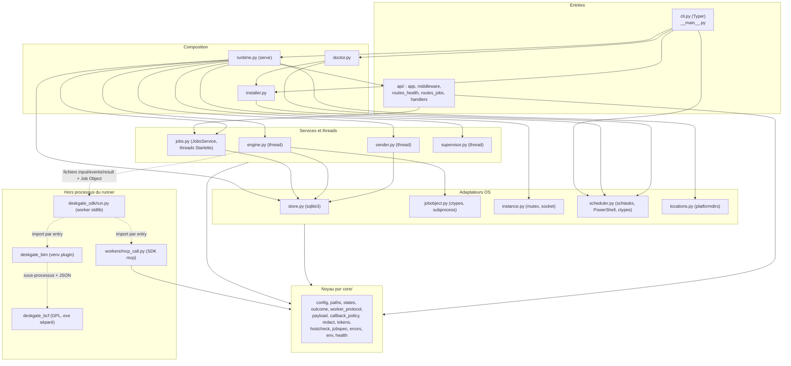
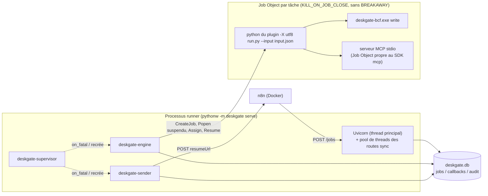
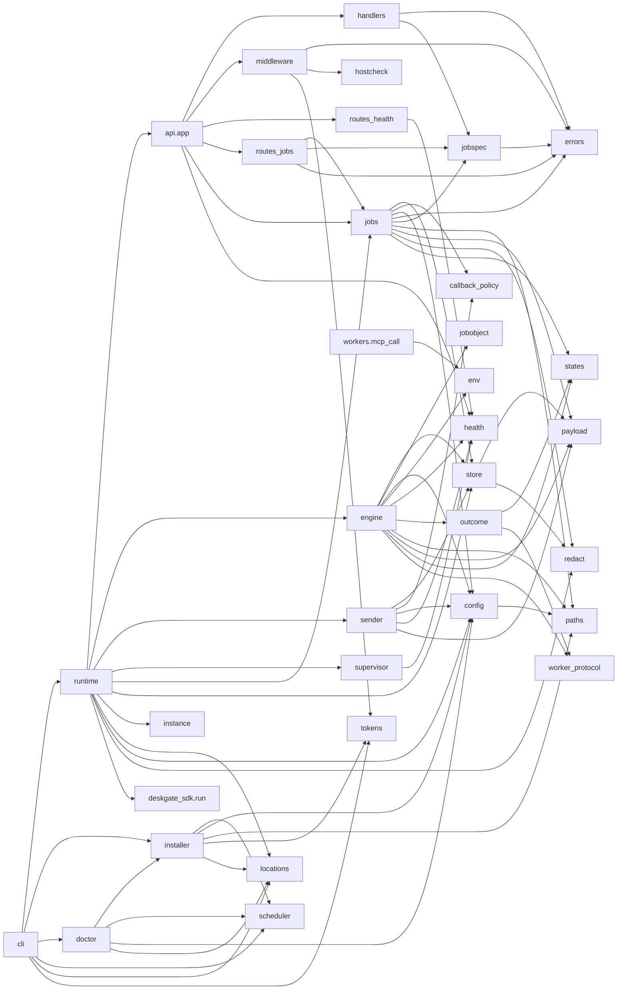
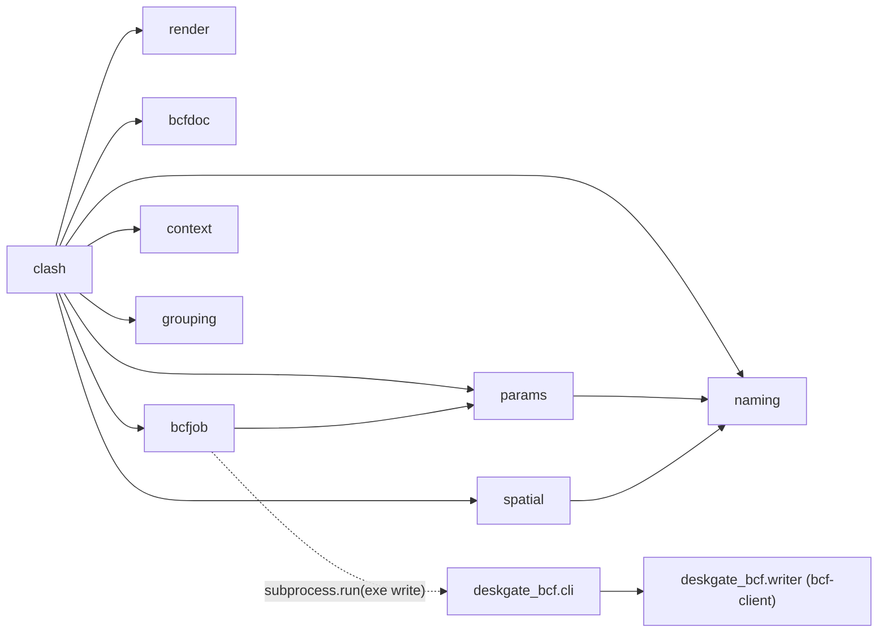

# Architecture — Deskgate

> Livrable dev-senior, Phases 0 et 1 seulement (reconnaissance et rétro-ingénierie). Aucun jugement,
> aucun finding (loi 3). Lecture seule : seul ce fichier a été écrit. Rapports d'audit antérieurs
> (`audits/`, `.arthemis/reports/*`) volontairement non lus. Date : 2026-10-23, commit `ce11da5`.
>
> Les citations `fichier:ligne` renvoient à l'arbre du commit ci-dessus. Couverture : tout `src/`
> (deskgate, deskgate_sdk), tout `plugins/bim/src/deskgate_bim/clash.py`, `params.py`, `bcfjob.py`,
> `bcfdoc.py`, `__init__.py`, `deskgate_bcf/cli.py` lus intégralement ; `context.py`, `grouping.py`,
> `naming.py`, `spatial.py`, `render.py`, `writer.py` lus par en-têtes et signatures ; tests lus
> seulement pour `tests/architecture/test_import_boundaries.py` ; `scripts/recette/` par en-têtes.

## Carte d'identité

### Langages et volumétrie (`git ls-files` + `wc -l` ; `tokei`/`cloc` absents)

| Zone | Fichiers .py | Lignes |
|---|---|---|
| `src/deskgate` (runner, MIT) | 39 | 5 515 |
| `src/deskgate_sdk` (worker stdlib, MIT) | 2 | 138 |
| `plugins/bim/src/deskgate_bim` (MIT) | 10 | 1 501 |
| `plugins/bim/bcf/src/deskgate_bcf` (GPL-3) | 3 | 314 |
| `tests/` (runner) | 108 | 11 291 |
| `plugins/bim/tests` + `plugins/bim/bcf/tests` | 22 | 2 608 |
| `scripts/recette` | 4 | 916 |

- Code de production ≈ 7 470 lignes ; tests ≈ 13 900 lignes (ratio tests/code ≈ 1,9). 578 fonctions
  `def test` sous `tests/`, 141 sous `plugins/`.
- Autres fichiers suivis : 211 `.md` (dont `.planning/`, `.arthemis/`, `docs/passation/`), 10 JSON
  (contrats BCF, workflow n8n), 4 TOML, 2 YAML (CI, compose), 7 `.log` (sous `.arthemis/reports/`).
- Plus gros fichiers de production : `engine.py` 715, `store.py` 637, `deskgate_bim/clash.py` 422,
  `scheduler.py` 408, `core/config.py` 333, `sender.py` 283, `supervisor.py` 276, `runtime.py` 272.
- Fichiers de `src/`/`plugins/` les plus modifiés (`git log --name-only`) : `runtime.py` 10,
  `engine.py` 10, `core/config.py` 7, `cli.py` 7, `deskgate_bim/clash.py` 7, `store.py` 6. 365 commits
  au total, premier le 2026-10-20.

### Écosystèmes

- **Python ≥ 3.11**, espace de travail `uv` à trois paquets (`pyproject.toml` racine,
  `[tool.uv.workspace] members = ["plugins/bim", "plugins/bim/bcf"]`), un seul `uv.lock`
  (versions résolues `deskgate`, `deskgate-bim`, `deskgate-bcf` = `0.1.0.dev0`, sources éditables).
  Backend `hatchling`. Le wheel `deskgate` embarque `src/deskgate` **et** `src/deskgate_sdk`.
- **Docker Compose** : `n8n/docker-compose.yml` (n8n `2.43.8` et Postgres 17, épinglés par digest).
- **n8n** : workflow d'exemple `n8n/examples/ifc-clash.json` (pas de nœud communautaire dans le dépôt).
- **CI** : `.github/workflows/ci.yml`, `windows-latest`, Python 3.11 et 3.13 : `uv sync --locked`,
  `ruff check`, `ruff format --check`, `pyright`, `pytest -m "not e2e"`, `uv build --all-packages`,
  `pytest -m e2e`.

### Points d'entrée (les « portes »)

| Porte | Fichier | Rôle |
|---|---|---|
| `deskgate` (console script) | `pyproject.toml` → `deskgate.cli:app` | CLI Typer : `serve`, `init`, `doctor`, `task install/remove/status/run/end`, `dev-token` (caché) |
| `python -m deskgate` | `src/deskgate/__main__.py` | Même CLI ; c'est l'action de la tâche planifiée (`pythonw.exe -m deskgate serve`) |
| HTTP `127.0.0.1:8765` | `src/deskgate/api/` | `GET /health` (public), `POST /jobs`, `GET /jobs/{id}`, `GET /jobs/{id}/logs`, `POST /jobs/{id}/cancel` |
| Threads de fond | `engine.py`, `sender.py`, `supervisor.py` | Boucles démarrées par `runtime.py:259-262` |
| Worker (processus fils) | `src/deskgate_sdk/run.py` | Lancé par chemin, avec l'interpréteur du plugin, dans un Job Object |
| Worker intégré `mcp` | `src/deskgate/workers/mcp_call.py:run` | Exécuté par `run.py` avec l'interpréteur du runner |
| Plugin `ifc.clash` | `deskgate_bim.clash:run` | Point d'entrée déclaré dans `runner.toml` |
| `deskgate-bcf` (console script GPL) | `deskgate_bcf.cli:main` | Sous-commande `write` uniquement |
| Tâche planifiée « Deskgate » | `scheduler.py:146` (XML) | Déclencheur ouverture de session |
| Migrations SQLite | `store.py:77-120` | `PRAGMA user_version` 1 → 2, appliquées par `open_db` |
| Scripts de recette | `scripts/recette/{recette,n8n_setup,bcf_check}.py` | Hors paquet ; lisent la base en lecture seule et pilotent `docker compose` |

### Dépendances externes

- **Base** : SQLite fichier `%LOCALAPPDATA%\Deskgate\deskgate.db` (`locations.py`), mode WAL
  (`store.py:173`), `synchronous=FULL`, `busy_timeout=5000`, `foreign_keys=ON` (`store.py:132-139`).
  Tables : `jobs`, `callbacks`, `audit` (triggers ajout seul).
- **Système de fichiers** : `runner.toml`, `logs\runner.log` (rotatif 2 Mio × 5), `logs\startup.log`
  (plafond 256 Kio), dossier partagé `C:/BIM` (`depot`, `travail`, `livrables`), un dossier par tâche
  `<work_root>/<job_id>/` avec `input.json`, `events.jsonl`, `result.json`, `cancel.flag`, `job.log`,
  `summary.json`, artefacts.
- **Réseau sortant** : POST vers la `resumeUrl` n8n (`httpx2`, `sender.py`). Entrant : n8n via
  `host.docker.internal:8765`.
- **API Windows** : `kernel32` (Job Objects, mutex nommé, `GetCurrentPackageFullName`), `ntdll`
  (`NtResumeProcess`), `schtasks.exe`, `powershell.exe` (`Get-ScheduledTaskInfo`).
- **Bibliothèques tierces** (runner) : fastapi 0.151, uvicorn 0.54, pydantic 2.14, typer 0.27,
  httpx2 2.15, mcp 2.3, platformdirs. (plugins) ifcopenshell 0.9.0.post1, ifcclash 0.9.0, pillow 13.0.0,
  numpy (transitif) ; bcf-client 0.9.0, jsonschema 4 (GPL).
- **Variables d'environnement lues** : `DESKGATE_HOME`, `DESKGATE_INSTANCE_NAME`, `DESKGATE_LOG_LEVEL`,
  `LOCALAPPDATA`, `USERDOMAIN`/`USERNAME`, `SYSTEMROOT` ; transmises aux enfants : liste blanche
  `core/env.py:7-28` + `PYTHONUTF8=1` + `DESKGATE_MCPENV__<SERVEUR>__<CLÉ>` ; posées par
  `deskgate_bim/__init__.py:8-9` : `OPENBLAS/OMP/NUMEXPR/MKL_NUM_THREADS=1` (`setdefault`).

### Outils de vérité-terrain (loi 5)

| Outil | État |
|---|---|
| `rg` | présent |
| `uv` / `uvx` / `npx` | présents (permettent `ruff`, `radon`, `vulture`, `pydeps`, `jscpd` en éphémère) |
| `ruff`, `pyright`, `pytest` | déclarés en groupe `dev` du projet, non installés globalement ; non exécutés (pas de build ni de test, consigne) |
| `tokei`, `cloc` | absents → volumétrie par `wc -l` |
| `jscpd`, `radon`, `vulture`, `pydeps` | absents en global, non lancés en Phase 0-1 (utiles en Phase 2) |
| `osv-scanner`, `semgrep`, `gitleaks` | absents |
| Graphe d'imports | **mesuré** par un script AST jetable (scratchpad, `python -I`), voir plus bas |

## Vue en couches

Style constaté : **monolithe modulaire mono-processus à « noyau fonctionnel pur + coquilles
impératives »**, avec SQLite comme bus d'intégration (file de tâches et boîte d'envoi des rappels).
Justification : `core/__init__.py` déclare « Noyau pur : aucun accès disque, réseau, base ni
sous-processus » et `tests/architecture/test_import_boundaries.py:14-23` l'impose (interdit `sqlite3`,
`subprocess`, `httpx2`, `fastapi`, `starlette`, `ctypes`, `uvicorn` dans `core/`) ; les décisions
(`states.step`, `outcome.verdict`, `callback_policy.classify`, `supervisor.decide`) sont des fonctions
pures appelées par des boucles à effets de bord (`engine`, `sender`, `supervisor`). L'exécution des
plugins est **hors processus** (contrat par fichiers).

Sens dominant : Entrées → Composition → Services → Adaptateurs → Noyau. Exceptions constatées :

- `api/app.py:15` importe `deskgate.jobs.JobsService` (la coquille HTTP dépend du service, pas d'une
  abstraction) ; `api/routes_jobs.py:12` aussi.
- `supervisor.py` ne dépend que de `core.health` et d'un `Protocol` `Restartable`
  (`supervisor.py:81-88`) : les instances réelles sont injectées par `runtime.py` (fabriques
  `make_engine`/`make_sender`/`recover`, `runtime.py:202-212`).
- `runtime.py:17` importe `deskgate_sdk.run` uniquement pour obtenir son `__file__`
  (`runtime.py:200`) : le script du worker est ensuite exécuté par chemin, par un autre interpréteur.
- `workers/mcp_call.py:18` importe `deskgate.core.env` : ce module s'exécute dans le processus worker
  (interpréteur du runner) et réutilise le noyau.
- `doctor.py:19` importe des constantes d'`installer.py` (`SHARE_DIRS`, `ZERO_HASH`).

Processus et threads à l'exécution :

## Graphe de dépendances

Mesure : script AST du scratchpad (imports absolus et relatifs résolus vers les modules du dépôt,
algorithme de Tarjan). Sortie : `CYCLES: aucun`.

Paquets plugins (aucun import vers `deskgate`) :

- **Cycles : aucun** (mesuré).
- `deskgate_sdk` n'importe rien du dépôt (stdlib seule, `run.py:1-4`).
- `deskgate_bim` n'importe ni `deskgate` ni `deskgate_bcf` ni `bcf` ; frontière contrôlée par
  `tests/architecture/test_import_boundaries.py:41-56`.
- Imports tiers confinés : `sqlite3` → `store.py` seul ; `httpx2` → `sender.py` seul ; `mcp` →
  `workers/mcp_call.py` seul ; `subprocess` → `jobobject.py` et `scheduler.py` ; `ctypes` →
  `jobobject.py`, `instance.py`, `scheduler.py` (liste figée par le test
  `test_ctypes_seulement_dans_jobobject`).

## Flux de données

### Flux 1 — Soumission `POST /jobs`

1. **Source** : nœud n8n « Soumettre a Deskgate » (`n8n/examples/ifc-clash.json`) : `POST
   http://host.docker.internal:8765/jobs`, corps `{capability, params, timeout, callback:{url:
   $execution.resumeUrl}}`, en-tête d'authentification générique.
2. **Contrôle Host** : `HostCheckMiddleware` (`api/middleware.py:31`) → `is_allowed_host`
   (`core/hostcheck.py:7` : `127.0.0.1`, `localhost`, `host.docker.internal`) ; sinon 400
   `host_not_allowed`. Ordre des middlewares : Host le plus externe (`api/app.py:46-47`).
3. **Jeton** : `BearerAuthMiddleware` (`api/middleware.py:51`), exempte `/health` seulement ;
   `verify_token` SHA-256 + `hmac.compare_digest` (`core/tokens.py:18`) ; sinon 401.
4. **Parsing** : FastAPI valide `SubmitRequest` (`core/jobspec.py:39`, `extra="forbid"`,
   `callback.url` `^https?://` ≤ 2048). Échec → `handlers._validation` (`api/handlers.py:50`) audite
   `invalid_request` puis 422 sans reprendre la valeur fautive.
5. **Route** synchrone `submit_job` (`api/routes_jobs.py:29`) → `JobsService.submit` (`jobs.py:100`) :
   - capacité dans `cfg.capabilities` (`jobs.py:101`) sinon 404 ;
   - délai effectif `resolve_timeout` (`core/jobspec.py:49`) : défaut `min(7200, timeout_max)`, refus
     au-delà de `timeout_max` (422) ;
   - URL de rappel `check_callback_url` (`core/callback_policy.py:107`) : ASCII visible, http(s), sans
     identifiants, hôte ∈ `callback_allowed_hosts` (défaut `localhost`, `127.0.0.1`) ;
   - chemins : `convert_mcp_arguments` (`core/paths.py:206`) ou `convert_path_params`
     (`core/paths.py:182`) ; **le résultat converti est jeté** (`jobs.py:116`) : la base garde les
     chemins d'origine (forme conteneur), l'engine reconvertit au lancement ;
   - chaque refus est audité par `_refuse` (`jobs.py:89`) dans une connexion propre, sans faire échouer
     la réponse.
6. **Persistance** : `store.insert_job` (`store.py:293`) en `BEGIN IMMEDIATE` : contrôle d'idempotence
   sur les tâches `queued`/`running` (`store.py:310-317`) doublé de l'index unique partiel
   (`store.py:96-97`) → 409 `idempotency_conflict` ; `INSERT jobs` avec `params_json` brut et
   `callback_url` **en clair** ; audit `job.submitted` avec paramètres masqués (`redact_params`) et
   plafonnés à 4 096 caractères (`store.py:237-243`), `client` = littéral `"bearer"` (`store.py:340`).
7. **Réveil** de l'engine (`jobs.py:158` → `runtime.py:216`, lambda qui relit `holder.engine` à chaque
   appel). Réponse `202 {job_id, status:"queued"}` (`api/routes_jobs.py:31`).

Changements de forme : JSON HTTP → modèle Pydantic `SubmitRequest` → `dict` → `json.dumps` →
colonne TEXT. `work_dir` calculé à la soumission (`jobspec.work_dir_for`, défaut
`<allowed_roots[0]>/travail/<job_id>`, `core/config.py:225`) et stocké.

### Flux 2 — Réclamation et exécution d'un plugin `python`

1. **Boucle** `Engine.run` (`engine.py:620`) : attente du réveil ou 0,5 s, puis `tick` (`engine.py:224`).
   Un verdict non écrit (`_unsettled`) est rejoué en priorité (`engine.py:228-230`).
2. **Réclamation** `store.claim_next` (`store.py:364`) : `UPDATE ... SET status='running'` sur la plus
   ancienne `queued` **à condition qu'aucune tâche ne soit `running`** (`store.py:371`) ; audit
   `job.started`. La colonne `resource` n'intervient pas.
3. **Lancement** `_launch_inner` (`engine.py:296`) :
   - capacité absente de la config → `spawn_failed` ;
   - **revalidation des chemins** au lancement (`engine.py:302-322`) ; la version convertie (chemins
     hôte) est celle transmise au plugin ;
   - branche python (`engine.py:353-359`) : interpréteur `cap.python`, `entry`, `pythonpath`,
     `settings` (table libre, opaque pour le runner) ;
   - `work_dir.mkdir(exist_ok=False)` (`engine.py:362`) ; `input.json` = `WorkerInput`
     (`core/worker_protocol.py`, écrit `engine.py:373-374`) ;
   - `argv = [python du plugin, -X, utf8, <site-packages du runner>/deskgate_sdk/run.py, --input,
     input.json]` (`engine.py:375-390`) ; environnement `build_env` = liste blanche + `PYTHONUTF8=1`
     (`core/env.py:31`).
4. **Job Object** `default_launcher` (`engine.py:120`) → `create_job` (`jobobject.py:155` :
   `KILL_ON_JOB_CLOSE`, `JOB_MEMORY` si `memory_mb`, jamais `BREAKAWAY_OK`) → `spawn_in_job`
   (`jobobject.py:176`) : `argv[0]` et `cwd` absolus, `Popen` en liste sans shell,
   `CREATE_SUSPENDED|CREATE_NO_WINDOW|CREATE_NEW_PROCESS_GROUP`, stdout+stderr → `job.log`,
   `AssignProcessToJobObject`, `NtResumeProcess`, `kill` si l'assignation échoue. Échéance monotone
   `clock() + timeout_s` (`engine.py:409`).
5. **Côté worker** `run.py:main` (`deskgate_sdk/run.py:96`) : retire le dossier du script de
   `sys.path` (`run.py:97`), lit `input.json`, crée `Ctx` (`run.py:65` : `log` → stderr → `job.log`,
   `progress`/`artifact` → `events.jsonl`, `cancelled()` = existence de `cancel.flag`), ajoute
   `sys_path`, importe `module:fonction` et l'appelle (`run.py:106`). Résultat écrit de façon atomique
   (tmp + fsync + `os.replace` avec réessais, `run.py:44-62`) : `{protocol, ok:true, summary, data,
   artifacts}` (artefacts renvoyés par le plugin, sinon ceux de `ctx.artifact`) ; toute exception →
   `{ok:false, error:{type: exc.error_code ou nom de classe, message[:2000]}}` et code 1
   (`run.py:119-133`).
6. **Observation** à chaque tour `_observe_inner` (`engine.py:441`) : `proc.poll()`,
   `is_cancel_requested` (lecture base), `_read_progress` (`engine.py:489` : lit `events.jsonl` depuis
   l'offset, ≤ 1 Mio, ne garde que le **dernier** événement `progress` → `store.update_progress`
   `store.py:382` ; les événements `artifact` sont ignorés), puis décision pure `step`
   (`core/states.py:46`).
7. **Sortie du processus** (`engine.py:460-469`) : pic mémoire lu si `memory_mb` (`engine.py:471`),
   `_reap` = `TerminateJobObject` puis `wait(5 s)` (`engine.py:482`) pour tuer les orphelins,
   `_evaluate` (`engine.py:508`) : lecture `result.json` ≤ 1 Mio + 1, `parse_result`
   (`core/worker_protocol.py:89`), chaque artefact résolu (`_artifact_host_path` `engine.py:710`,
   relatif → sous `work_dir`) puis `validate_artifact_path` (`core/paths.py:172` : dans les racines après
   résolution, puis conversion hôte → conteneur), `verdict` (`core/outcome.py:47`), requalification
   `memory_limit` si pic ≥ 95 % (`core/outcome.py` `memory_exhausted`). `result_json = {summary, data,
   artifacts(chemins conteneur)}` ; `_cap_summary` (`engine.py:554`) déporte `summary` dans
   `summary.json` si le corps du rappel dépasserait 1 Mio.
8. **Conclusion** `_conclude` (`engine.py:603`) → `store.finish` (`store.py:397`) → `_terminal`
   (`store.py:270`) : dans **une** transaction, `UPDATE jobs ... WHERE status='running'`, insertion d'une
   ligne `callbacks` `pending` (`not_before = now + 2 s`, `store.py:254-258`), audit `job.<statut>`.
   Puis `_release` ferme la poignée du Job.

Copies et changements de forme : `params` existe en base (forme conteneur), dans `input.json` (forme
hôte) et dans la mémoire du plugin ; `result.json` (forme du plugin, chemins hôte) → `ResultOk` →
`jobs.result_json` (chemins conteneur) → corps du rappel. Le champ `data` est persisté dans
`result_json` mais n'est exposé ni par `GET /jobs/{id}` (`jobs.py:50-72`) ni par le rappel
(`core/payload.py:1-4`).

### Flux 3 — Appel `mcp.call`

1. **Soumission** : `params = {server, tool, arguments, call_timeout_s}` ; seuls les arguments de
   premier niveau listés dans `[mcp_servers.<nom>].path_arguments[<outil>]` sont validés
   (`core/paths.py:206-228`) ; serveur/outil inconnus → params renvoyés tels quels (le worker refusera).
2. **Lancement** branche mcp (`engine.py:328-352`) : interpréteur = celui du runner
   (`sys.executable`, `engine.py:194`), `entry = "deskgate.workers.mcp_call:run"` (`engine.py:157`),
   `settings.servers` = tous les serveurs déclarés (commande, args, `allowed_tools`, **noms** des clés
   d'env) ; **valeurs** d'env du seul serveur visé passées en variables `DESKGATE_MCPENV__<S>__<K>`
   (`core/env.py:45`), jamais écrites dans `input.json`.
3. **Worker** `mcp_call.run` (`workers/mcp_call.py:131`) → `anyio.run(_call)` :
   `_validate` (`mcp_call.py:40`, délai d'appel défaut 60 s, plafond 3 600 s), serveur déclaré et outil
   dans `allowed_tools` (`mcp_call.py:66-71`), reconstitution de l'env depuis les variables
   (`mcp_call.py:72-76`), `StdioServerParameters(command absolu, args, env, cwd=work_dir)`.
4. **Appel** : groupe de tâches avec un `watcher` qui lit `cancel.flag` toutes les 0,25 s et annule la
   portée (`mcp_call.py:83-92`) ; `Client(sp, read_timeout_seconds)` puis `call_tool`
   (`mcp_call.py:94-98`).
5. **Classement** (`mcp_call.py:104-128`) : annulé → `summary {cancelled:true}` ; exception de
   transport → `server_unreachable` ; `MCPError` `REQUEST_TIMEOUT` → `call_timeout` ; autre
   `MCPError` → `mcp_error` ; `is_error` → `tool_error` (texte ≤ 500) ; succès → `data
   {structured_content, content[]}` ; au-delà de 900 000 octets → artefact `mcp-result.json`
   (`kind = mcp_result`) et `data {truncated:true}`.
6. Les erreurs `McpCallError.error_code` deviennent `error.type` (via `run.py`) puis
   `plugin_error` avec message `type : message` côté engine (`engine.py:539-541`).

Arbre de processus : Job de la tâche ⊃ worker (Python du runner) ⊃ serveur MCP stdio, que le SDK `mcp`
place en plus dans son propre Job Object (selon `CLAUDE.md`, non relu dans le SDK).

### Flux 4 — Conclusion d'une tâche (succès, échec, délai, annulation)

| Issue | Déclencheur | Écriture | Code d'erreur |
|---|---|---|---|
| `succeeded` | sortie 0, résultat valide, artefacts dans les racines | `engine._conclude` → `store.finish` | — |
| `failed` | `plugin_error`, `result_too_large`, `invalid_result`, `missing_result`, `nonzero_exit`, `artifact_outside_roots` (`core/outcome.py` `_base_verdict`) ; `memory_limit` (requalification) | idem | stable, `core/outcome.py:10-21` |
| `failed` au lancement | capacité absente, `path_*` à la revalidation, `OSError`/`ValueError` au lancement (`spawn_failed`, `engine.py:392-402`), toute autre exception (`engine_error`, `engine.py:291-294`) | `engine._fail` | idem |
| `failed` en suivi | exception interne pendant l'observation : Job tué puis `engine_error` (`engine.py:423-432`) | idem | `engine_error` |
| `timeout` | `step` : `now >= deadline` sans annulation → `kill` (`core/states.py:56-57`) ; `_reap` puis `kill_verdict` (`core/outcome.py:85`) | idem | `timeout` |
| `cancelled` (en file) | `POST /jobs/{id}/cancel` → `JobsService.cancel` (`jobs.py:168`) → `store.request_cancel` (`store.py:423`) : `queued → cancelled` direct, avec rappel et audit | `store._terminal` (API) | `cancelled` |
| `cancelled` (en cours) | `cancel_requested=1` + audit (`store.py:444-446`), réveil engine ; tour suivant : `cancel.flag` écrit (`engine.py:450-453`) ; sortie du plugin → `cancelled` quel que soit le résultat ; sinon grâce 10 s (`engine.py:171`) puis `kill` | `engine._conclude` | `cancelled` |
| `interrupted` | recovery au démarrage (flux 6) ou par le superviseur (flux 7) | `store.recover_interrupted` | `runner_restarted` |

Invariants observables dans le code : toute écriture terminale passe par `_terminal`
(`store.py:270`) ou `recover_interrupted` (`store.py:451`), qui insèrent chacune une ligne `callbacks`
dans la même transaction ; `callbacks.job_id` est `UNIQUE` (`store.py:100`) ; la garde
`WHERE status=<from>` lève `StaleTransition` (journalisée, sans rappel, `engine.py:254-255`). Ordre de
décision par tour : sortie du processus, puis annulation, puis échéance (`core/states.py:1-9`).

### Flux 5 — Rappel vers n8n (outbox, sender, réessais)

1. **Boucle** `Sender.run` (`sender.py:231`) : attente 1 s (ou réveil) puis `tick` en boucle tant
   qu'il y a du travail. L'engine **ne réveille pas** le sender ; seul le superviseur le fait après une
   recréation d'engine (`supervisor.py:213`).
2. **Réclamation** `store.claim_due_callback` (`store.py:517`) : ligne `pending` échue
   (`next_attempt_at` et `not_before` ≤ maintenant) la plus ancienne ; si `now ≥ finished_at +
   max_window_s` (défaut 86 400 s) → `abandoned_exhausted` sans envoi ; sinon `attempts+1` et
   `maybe_delivered=1` écrits **avant** l'envoi (`store.py:546-550`).
3. **Revérification de l'hôte** `_host_allowed` (`sender.py:204`) contre la config courante et
   l'analyse `httpx2.URL` ; refus → `abandon_callback` `abandoned_rejected` (`sender.py:131-140`).
4. **Corps** `build_callback` (`core/payload.py:34`) depuis la ligne `jobs` : `job_id, capability,
   status, duration_s, summary, artifacts, error` ; corps minimal si > 1 Mio ou si le dernier statut
   était 413 (`sender.py:151-152`).
5. **Envoi** `_send` (`sender.py:213`) : `httpx2.Client` (`sender.py:60` : 30 s, connexion 5 s, sans
   redirection, `trust_env=False`, sans keep-alive), URL passée telle quelle ; en cas d'erreur seul le
   **nom de classe** de l'exception est retenu ; corps de réponse non-2xx lu sur 4 096 octets.
6. **Classement** `classify` (`core/callback_policy.py:49`) : 2xx `delivered` ; 409 « finished » →
   `delivered_duplicate` si `maybe_delivered` sinon `abandoned_stale` ; 409 « running/about to resume »
   → réessai court ; 401/403/404 → confirmés sur deux essais consécutifs puis `abandoned_stale` (404)
   ou `abandoned_rejected` ; 413 → un renvoi minimal ; réseau et autres → réessai.
7. **Délai** `next_delay` (`core/callback_policy.py:79`) : 2 s × 2^(n-1) ±25 %, plafond
   `max_backoff_s` (300) ; court : 2 s × 1,5^(n-1), plafond 30 s. Si le prochain essai tombe au-delà de
   la fenêtre → `abandoned_exhausted` (`sender.py:172-173`).
8. **Écriture** `record_callback_result` (`store.py:568`) : état, statut HTTP, erreur masquée
   (`redact_signature`), `maybe_delivered` restauré sur 4xx, prochain essai ; audit `callback.attempt` ;
   état final → `_close_callback` (`store.py:500`) : `callbacks.state`, **purge de
   `jobs.callback_url`** (`''`), audit `callback.delivered`/`callback.abandoned`.
9. **Côté n8n** : le nœud Wait « On Webhook Call » (limite 6 h dans l'exemple) reprend ; le nœud If
   teste `$json.body?.status`.

Erreurs du thread : toute exception d'un tour → reconnexion et back-off `min(30, 2^n)` ; 5 erreurs
consécutives → `failed` + `on_fatal` (`sender.py:241-249`).

### Flux 6 — Redémarrage du runner (recovery `interrupted`)

Séquence `runtime._serve` (`runtime.py:151`) :

1. `attach_startup_log` avant tout (`runtime.py:140`) ; `load_config` (`runtime.py:153`) → code 2.
2. Mutex nommé `Local\Deskgate` (`instance.py:38`, nom surchargeable par `DESKGATE_INSTANCE_NAME`)
   → code 3.
3. Journal fichier rotatif (`runtime.py:167`).
4. Socket `SO_EXCLUSIVEADDRUSE` lié avant Uvicorn (`instance.py:53`) → code 4.
5. `open_db` : WAL + migrations (`store.py:168`) → code 5 (`SchemaTooNew` ou `DatabaseError`).
6. `recover_interrupted` (`store.py:451`) : en une transaction, toute ligne `running` → `interrupted`
   (`runner_restarted`), une ligne `callbacks` `pending` et un audit chacune ; **sans lire le disque**
   (un `result.json` présent est ignoré).
7. Construction `Holder`, `JobsService`, `Supervisor`, application ; démarrage des trois threads
   (`runtime.py:259-262`) ; `server.run(sockets=[sock])` (`runtime.py:264`).

Fin de processus : la mort du runner ferme les poignées de Job → `KILL_ON_JOB_CLOSE` tue l'arbre du
plugin. Arrêt propre : `lifespan` → `on_shutdown` (`api/app.py:30-34`) puis `finally`
(`runtime.py:265-268`) : `engine.stop` tue le Job courant mais **laisse la ligne `running`**
(`engine.py:678-700`), conclue au démarrage suivant. Relance du processus : uniquement par la tâche
planifiée (ouverture de session) ou `deskgate task run` ; `RestartOnFailure` (1 min × 3,
`scheduler.py:174-176`) ne couvre que les échecs de démarrage (constat cité par `ARCHITECTURE.md` §2 et
`supervisor.py:8-9`).

### Flux 7 — Mort d'un thread et superviseur

1. **Engine** : `OperationalError` SQLite → connexion rouverte, back-off `min(30, 2^n)`
   (`engine.py:86`, `631-653`) ; un verdict calculé mais non écrit est gardé en `_unsettled`
   (`engine.py:256-262`) et rejoué. Au-delà de 5 erreurs consécutives, ou sur toute exception qui
   remonte jusqu'à `run` → `failed=True`, `on_fatal()` (`engine.py:654-658`).
2. **Sender** : voir flux 5.
3. **Superviseur** : `notify` pose un événement (`supervisor.py:134`) ; boucle période 1 s
   (`supervisor.py:245`) → `check` (`supervisor.py:142`) → `decide` (`supervisor.py:58`) : abandon si
   ≥ 10 échecs consécutifs de recovery ou si plus de 3 recréations effectives en 600 s.
4. `_restart_engine` (`supervisor.py:181`) : `old.stop()` (tue le Job courant), puis `recover()`
   (`runtime.py:208-212` : nouvelle connexion + `recover_interrupted`) ; échec → compteur et nouvel
   essai après `min(30, 2^n)` s (`supervisor.py:186-199`) ; succès → nouvel `Engine`, démarré, installé
   dans le `Holder`, compté, `sender.wake()`.
5. `_restart_sender` (`supervisor.py:223`) : arrêt, recréation, démarrage (sans recovery).
6. **Abandon** → `on_give_up` met `server.should_exit` (`runtime.py:219-221`) → arrêt Uvicorn →
   `exit_code(gave_up=True)` = 6 (`supervisor.py:77`, `runtime.py:269`) et message dans
   `startup.log`.
7. **Observabilité** : `/health` (`api/routes_health.py:15`) publie `engine`/`sender` ∈
   `ok|failed|stale` (`core/health.py`) ; `stale` (thread vivant mais sans tour) n'entraîne aucune
   action. Limites écrites par les auteurs : verdict `_unsettled` perdu à la mort de l'engine
   (`supervisor.py:14-16`) ; thread bloqué non recréé (`engine.py:11-12`).

### Flux 8 — Installation (init, task install, doctor, MSIX)

1. **Paquet** : `uv tool install .` → exécutable `deskgate` (`pyproject.toml` `[project.scripts]`).
2. **`deskgate init`** (`cli.py:107`) : `resolve_home` (`locations.py`, `DESKGATE_HOME` sinon
   `platformdirs.user_data_dir("Deskgate")`) ; `refuse_if_packaged` (`installer.py:59`) →
   `scheduler.packaged_context` (`scheduler.py:104`) : identité de paquet
   (`GetCurrentPackageFullName`), sonde d'écriture sous `%LOCALAPPDATA%` retrouvée dans
   `Packages/*/LocalCache/Local`, heuristique sur `DESKGATE_HOME` ; `normalize_root` (UNC refusé) ;
   `init_config` (`installer.py:119`) : dossiers `depot/travail/livrables` sous la racine, `logs` et
   `plugins` sous le dossier du runner ; config conservée si présente sans `--force`, sinon sauvegarde
   `.bak-<horodatage>`, jeton `secrets.token_urlsafe(32)`, gabarit `runner.example.toml` (ressource du
   paquet) avec remplacement de l'empreinte nulle et de la racine, réécriture puis relecture
   validante. Jeton sur stdout seul (`cli.py:130-131`).
3. **Tâche** : `_confirm_task` refuse si `DESKGATE_HOME` est défini (`cli.py:91-103`) ;
   `install_task` (`installer.py:152`) : `pythonw.exe` voisin de `sys.executable`
   (`scheduler.py:137`), arguments `-m deskgate serve`, dossier de travail = dossier du runner ;
   tâche existante conforme → rien ; sinon XML construit par ElementTree, UTF-16
   (`scheduler.py:146`), fichier temporaire dans le dossier du runner, `schtasks /Create /XML /TN
   Deskgate /F` (`scheduler.py:286`). `task status/run/end/remove` → `schtasks` (`scheduler.py:301-316`).
4. **`deskgate doctor`** (`cli.py:76` → `doctor.run_all`, `doctor.py:200`) : contexte MSIX,
   `DESKGATE_HOME`, config, dossiers, empreinte non nulle, tâche (audit XML, `pythonw.exe`, arguments,
   dernier résultat via PowerShell `Get-ScheduledTaskInfo` avec le nom passé par variable
   d'environnement, `scheduler.py:348` ; classement `0x8007010B` = virtualisé, codes 2-6 du runner),
   port (`GET /health` via `urllib`, sinon tentative de liaison, `doctor.py:85`), plugins (interpréteur,
   `required_files`, exécutables MCP). Code 1 si un `echec`.
5. **Plugins** : environnements créés à la main (`uv sync --locked --package ... --no-dev` avec
   `UV_PROJECT_ENVIRONMENT`, AGENTS.md §4), chemins recopiés dans `runner.toml`.
6. **n8n** : `docker compose` du dépôt ; `scripts/recette/n8n_setup.py` crée propriétaire,
   identifiant (jeton par stdin du conteneur) et workflow.

### Flux 9 — Plugin `ifc.clash` → `deskgate-bcf` (frontière GPL)

1. **Déclaration** (`runner.example.toml:55-71`) : `kind="python"`, `entry="deskgate_bim.clash:run"`,
   `path_params=["ifc_a","ifc_b"]`, `settings.bcf_executable` (+ `required_files`), `settings.threads`,
   `memory_mb`, `resource="cpu-heavy"`.
2. **Import** dans le venv du plugin : `deskgate_bim/__init__.py:8-9` pose les plafonds de threads BLAS
   à 1 avant numpy ; `clash.run` (`clash.py:417`) → `parse_params` (`params.py:100`, Pydantic strict)
   → `ClashError("invalid_params")`. `MemoryError` → `ClashError("memory")`.
3. **Calcul** `_run` (`clash.py:277`) : threads = paramètre, sinon `settings.threads`, sinon
   `min(4, cpu)` ; ouverture IFC (`_open`, `clash.py:158`) ; `DeskgateClasher.process_clash_set`
   (`clash.py:111`, sous-classe d'`ifcclash.Clasher`, arbre `ifcopenshell.geom`) ; progression 0-90 %.
4. **Post-traitement** : `prepare`/`build_groups` (`grouping.py`, GUID de groupe déterministes) ;
   `clashes.json` complet écrit et déclaré artefact (`clash.py:349-351`).
5. **BCF** si `bcf` et au moins un groupe : `_write_bcf` (`clash.py:184`) : contexte gris
   (`context.py`), titres (`spatial.py`/`naming.py`, erreurs rétrogradées en avertissements),
   `build_doc` (`bcfdoc.py:80`, document `schema_version: 2`), images (`render.py`, Pillow + numpy) sous
   `work_dir/snapshots`, puis `write_bcf` (`bcfjob.py:17`) : `bcf_executable` absolu et existant,
   `bcf-input.json` écrit, `subprocess.run([exe, "write", "--input", ..., "--output",
   "conflits.bcf"])` en liste, sans shell, `CREATE_NO_WINDOW`, délai 1 800 s, environnement hérité du
   worker ; le fils reste dans le Job ; code 2 → `bcf_contract_error`, autre ≠ 0 → `bcf_write_failed` ;
   artefact `bcf` (`clash.py:272-273`).
6. **Côté GPL** `deskgate_bcf.cli.main` (`bcf/src/deskgate_bcf/cli.py:56`) : lecture JSON,
   `schema_version ∈ {1,2}`, validation `jsonschema` contre le schéma embarqué, contrôle des images
   (dans le dossier d'entrée, PNG, ≤ 2 Mio, `cli.py:28`) → code 2 ; dossier de sortie absent → 3 ;
   `writer.write` (seul module qui importe `bcf`) → 3 sur exception.
7. **Allègement** de `data` sous `settings.data_max_bytes` (défaut 900 000) : paires puis groupes omis
   (`clash.py` ~371-397) ; retour `{summary, data}` sans clé `artifacts` → `run.py` prend
   `ctx.artifacts`.

Seuls échanges à travers la frontière GPL : fichiers `bcf-input.json`, `snapshots/*.png`,
`conflits.bcf`, code de sortie, stderr (UTF-8). Le contrat JSON existe en trois copies
(`docs/contrats/`, `deskgate_bim/contracts/`, `deskgate_bcf/schemas/`), vérifiées identiques par
`tests/plugins/test_contract_equality.py` ; le code de `deskgate_bim` ne lit pas sa copie (aucune
référence dans `deskgate_bim/*.py`), seul `deskgate_bcf` lit la sienne.

## Frontières implicites et couplages invisibles

- **Contrat de fichiers runner ↔ worker** : noms `input.json`, `events.jsonl`, `result.json`,
  `cancel.flag`, `job.log` et clés, dupliqués en littéral dans `deskgate_sdk/run.py` (`CONTRACT`) et
  dérivés des modèles dans `core/worker_protocol.py` (`CONTRACT`) ; l'égalité est un test
  (`tests/unit/test_sdk_contract.py`, non lu).
- **Exécution croisée d'environnements** : l'interpréteur du venv du plugin exécute un fichier situé
  dans le venv de l'outil `deskgate` (`runtime.py:200`). Le worker `mcp` utilise l'interpréteur du
  runner (`pythonw.exe` sous la tâche planifiée).
- **Classement d'erreur par attribut** : `run.py:122-123` lit `exc.error_code` (typage canard) ;
  `ClashError` (`params.py:25`) et `McpCallError` (`mcp_call.py:26`) le portent.
- **Table `settings` opaque** : le runner la transmet sans la lire ; seules `required_files` la
  relient au doctor. Les clés `bcf_executable`, `threads`, `snapshot_size`, `data_max_bytes` ne sont
  connues que du plugin.
- **Mémoire et threads** : le plafond mémoire passe par le Job Object (pas par variable
  d'environnement) ; aucune variable de threads n'est posée par le cœur, c'est `deskgate_bim/__init__`
  qui pose `OMP_NUM_THREADS` etc. à 1 et le plugin qui lit `settings.threads`.
- **Nommage d'env MCP partagé** `mcp_env_var` (`core/env.py:45`) entre engine (écriture) et worker
  (lecture).
- **Codes de sortie du runner dupliqués** : `runtime.py:48-52` / `supervisor.py:32` et
  `scheduler.py:332-338` (`_RUNNER_EXIT`, utilisé par le doctor).
- **État partagé mutable** : `Holder` (`supervisor.py:91`) modifié par le thread superviseur, lu par
  la lambda de réveil (`runtime.py:216`) et par `/health` (`runtime.py:242-245`) sans verrou ;
  `instance._HELD` global garde le mutex jusqu'à la fin du processus.
- **Concurrence par la base** : quatre écrivains de `jobs` (API : insertion et annulation ; engine :
  réclamation, progression, verdict ; superviseur et démarrage : recovery ; sender : purge de
  `callback_url`), synchronisés uniquement par `BEGIN IMMEDIATE` et les gardes `WHERE status=?`.
  Connexions par appel (API) ou par thread (engine, sender), jamais partagées (`store.py:1-5`).
- **Déclenchement par sondage** : engine 0,5 s, sender 1 s, superviseur 1 s ; `not_before = +2 s` sur
  chaque rappel. Pas de réveil engine → sender.
- **Deux horloges** : échéance des tâches en monotone (`engine.py:409`) ; horodatages base, fenêtre de
  rappel et délais en UTC mural (`store.iso`).
- **Secret en base** : `jobs.callback_url` en clair de la soumission jusqu'à l'état final du rappel
  (`store.py:510`) ; masquage par motif `signature=` (`core/redact.py:13-14`) sur les journaux
  (formatter + filtre posés sur chaque handler), l'audit et `GET /jobs/{id}/logs` (`jobs.py:206`).
- **Journalisation globale** : `configure_logging` remplace les handlers racine
  (`runtime.py:64-84`) ; `RedactingFilter` réécrit `record.msg` et vide `record.args`
  (`core/redact.py:47-53`).
- **Chargement Windows à l'import** : `instance.py` et `jobobject.py` chargent `kernel32`/`ntdll` au
  niveau module ; `runtime` (donc `cli`) n'est importable que sous Windows.
- **Couplage hors paquet au schéma** : `scripts/recette/_commun.py:30-31,158` lit
  `%LOCALAPPDATA%\Deskgate\deskgate.db` en lecture seule et `recette.py` interroge `jobs` et
  `callbacks` par SQL brut.
- **Réglages répartis entre dépôts/outils** : délai du Wait n8n (6 h dans l'exemple), `timeout_max`
  de la capacité (14 400 dans l'exemple), fenêtre de rappel (`max_window_s` 86 400),
  `N8N_WEBHOOK_URL` (`127.0.0.1:5679`) qui doit correspondre à `callback_allowed_hosts`.
- **Installation éditable des plugins** : le code du plugin est relu depuis le dépôt à chaque tâche
  (AGENTS.md §4, sources `editable` dans `uv.lock`).
- **Unicité d'exécution globale** : une seule tâche `running` à la fois, toutes capacités confondues
  (`store.py:371`) ; `resource` est stocké mais non lu.

## Zones non élucidées

- **Environnement du serveur MCP stdio** : `StdioServerParameters(env=...)` ne reçoit que les clés
  déclarées (`mcp_call.py:72-79`) ; je n'ai pas vérifié dans le SDK `mcp` 2.3 si celui-ci ajoute sa
  propre liste blanche (`SYSTEMROOT`, `PATH`…) ou n'utilise que ce dictionnaire.
- **Imbrication des Job Objects** avec le SDK `mcp` (`mcp.os.win32`) : comportement de
  `TerminateJobObject` du runner sur le Job interne non relu dans le SDK (test
  `tests/proc/test_mcp_tree.py` existant, non lu ni exécuté).
- **`events.jsonl` côté plugin** : ouvert en `ab` sans tampon et jamais fermé explicitement
  (`run.py:74-76`) ; interaction exacte avec la lecture par offset de l'engine (lignes partielles) non
  éprouvée.
- **« Plantage de Rich »** mentionné par AGENTS.md pour `deskgate doctor` dans un tube : `doctor`
  n'écrit que par `typer.echo` ; l'origine (Typer/Rich, encodage reconfiguré `cli.py:21-23`) n'a pas
  été reproduite.
- **Modules BIM lus par signatures seulement** : `context.py`, `grouping.py`, `naming.py`,
  `spatial.py`, `render.py`, `deskgate_bcf/writer.py` (logique géométrique, rendu, xsdata).
- **Tests** : non exécutés ; couverture réelle et marqueurs effectivement passés en CI inconnus (la
  CI lance `pytest -m "not e2e"` après un `uv sync --locked` sans les venvs de plugins ; comportement
  des tests `bim` dans ce contexte non vérifié).
- **`deskgate_bim` et l'export BCF d'`ifcclash`** : `from ifcclash import ifcclash` ; je n'ai pas
  vérifié si ce module importe `bcf` de façon paresseuse ou à l'import (test
  `tests/plugins/test_no_bcf_in_bim_env.py` existant, non lu).
- **Comportement sous `pythonw`** de la sortie des workers MCP et du flux de `job.log` (redirection
  héritée) : non observé.
- **Purge** : aucun code de purge des dossiers de tâche, de la table `audit` (ajout seul) ni de
  `jobs` n'a été trouvé (`runner.example.toml:30-31` le dit pour les dossiers).

## Écarts entre la documentation des auteurs et le code (factuels)

| Document | Affirmation | Code |
|---|---|---|
| ARCHITECTURE §1, §4 | Exécuteurs `python │ cli │ mcp` | `Capability.kind: Literal["python","mcp"]` (`core/config.py:119`) ; aucun exécuteur `cli` |
| ARCHITECTURE §1, §6 | Routes `/capabilities`, `/capabilities/{id}`, `/jobs/{id}/artifacts/{name}`, `/ui` | Seules `/health`, `POST /jobs`, `GET /jobs/{id}`, `/logs`, `/cancel` (`api/routes_*.py`) |
| ARCHITECTURE §6 | « OpenAPI générée » | `FastAPI(docs_url=None, redoc_url=None, openapi_url=None)` (`api/app.py:36`) |
| ARCHITECTURE §2 | SQLite contient « journaux de tâche, jetons hachés, état des plugins » | Tables `jobs`, `callbacks`, `audit` seulement ; jeton dans `runner.toml` ; journaux en fichiers |
| ARCHITECTURE §3 | Concurrence maximale par ressource (`gui-session`=1, `light`=N) | Une seule tâche `running` globale (`store.py:371`) ; `resource` stockée, non lue |
| ARCHITECTURE §3 | Idempotence : une tâche réussie de même clé renvoie son résultat sans recalcul | Clé refusée (409) seulement si une tâche `queued`/`running` la porte ; aucune réutilisation de résultat (`store.py:96-97, 310-317`) |
| ARCHITECTURE §3 | Plafond de mémoire et de threads transmis par variables d'environnement | Mémoire via Job Object ; aucune variable de threads posée par le cœur (posées par `deskgate_bim/__init__.py:8-9`) |
| ARCHITECTURE §5 | Serveurs MCP dans `mcp_servers.toml` ; champs v0.1 `kind, python, entry, timeout_max, resource` | `[mcp_servers]` dans `runner.toml` ; champs en plus : `pythonpath`, `memory_mb`, `settings`, `path_params`, `required_files` |
| ARCHITECTURE §8 | Audit avec « client » ; jetons par client | Un jeton ; `client` = littéral `"bearer"` (`store.py:340`) |
| ARCHITECTURE §11 | `deskgate-bcf` lit aussi un `.bcf` et rend du JSON ; plugins `bcf.write`/`bcf.read` de type `cli` | Sous-commande `write` seule (`deskgate_bcf/cli.py:47-53`) ; aucune capacité `bcf.*` |
| ARCHITECTURE §12 | Dossiers `queue/`, `executors/`, `plugins/`, `security/`, `ui/`, `plugins/examples/`, `n8n/node/` | Modules à plat + `core/`, `api/`, `workers/` ; ni `plugins/examples` ni `n8n/node` |
| ARCHITECTURE §4 | Annulation = `TerminateJobObject` | Annulation coopérative d'abord (`cancel.flag`, grâce 10 s) puis `TerminateJobObject` (`engine.py:450-458`, `171`) |
| ARCHITECTURE §0 | Projet et plugins d'exemple dans le dépôt | Aucun plugin d'exemple ; `tests/fake_plugins/` et `tests/mcp_fake/` servent aux tests |
| AGENTS §2 | `git clone https://github.com/<organisation>/deskgate.git` | URL générique non renseignée |
| Commentaires de code | `jobobject.py:3-4` « seul à importer `subprocess` » ; `instance.py:3` « seul autorisé à importer `ctypes` en phase 1 » | `scheduler.py:12,16` importe aussi `ctypes` et `subprocess` (admis par le test `test_import_boundaries.py:79`) |

Points vérifiés **conformes** : écoute `127.0.0.1` par défaut et refus d'une autre interface sans
`allow_non_loopback` (`core/config.py:228-240`) ; jeton sur toutes les routes sauf `/health` ;
ordre de démarrage et code 6 du superviseur (3 recréations en 10 min, 10 échecs de recovery avec
2/4/8/16/30 s) ; tâche planifiée (`InteractiveToken`, `LeastPrivilege`, `PT0S`, batterie, `IgnoreNew`,
`pythonw.exe -m deskgate serve`) ; plafond du rappel 1 Mio et `summary.json` ; options de
`deskgate init` (`--root`, `--force`, `--no-task`, `--yes`) et refus si `DESKGATE_HOME` ; sous-commandes
`task install|status|run|end|remove` ; jeton seul sur stdout ; compose n8n `2.43.8` épinglé par digest
sur `127.0.0.1:5679` avec `N8N_WEBHOOK_URL` ; exemples `ifc.clash`, `mcp.call`, `mcp_servers` dans le
gabarit.
